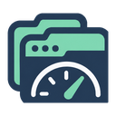

# Tabometer

Tabometer is a local-only Firefox extension that tracks how many tabs you have open and how long they have been inactive. It offers neutral observations to help you notice patterns over time; tab counts do not measure productivity or diagnose stress.

## What it measures

- **Open tabs**, including pinned, hidden, and discarded tabs across normal windows.
- **Tabs inactive for at least 7 days** and **at least 30 days**, excluding pinned tabs. The 30-day count is also included in the 7-day count.
- **Unknown inactivity**, shown separately when a tab has no usable access timestamp.

Private windows and popup windows are excluded. Inactivity uses Firefox-reported access times, which can change during restoration; it is not a precise measure of attention. Tabometer knows when it first observed a tab, not when a preexisting tab was originally opened.

## Install

Requires **Firefox desktop 112 or newer**; a current supported release is recommended. This is a development build, installed temporarily from this repository:

1. Download or clone the repository.
2. Open `about:debugging` in Firefox.
3. Choose **This Firefox → Load Temporary Add-on** and select `manifest.json`.
4. Click Tabometer in the extensions menu or toolbar to open its settings page. You can also use **Preferences** in `about:addons`.

**Firefox removes temporary add-ons when it exits.** For development and restart testing, see [installation details](docs/development.md#temporary-installation-and-restart-testing).

## Everyday use

The settings page shows the latest counts, daily observations, storage usage, and collection errors. It follows your light/dark theme and includes expandable data inspectors.

- **Sample now** collects a fresh reading. **Refresh status** displays the stored readings and current status.
- Sampling defaults to browser events plus a **15-minute interval**. You can change the interval or choose events-only or periodic sampling. Events-only can leave quiet days unmeasured.
- Each daily entry is the **last observed reading for that local calendar date**. Today's entry is provisional and can be replaced by later samples.
- Firefox being closed or asleep creates gaps, not zero counts or reconstructed readings.
- Daily readings are kept for **30 calendar days including today**, configurable from 1 to 365. Retention cleanup runs on successful sampling.

## Optional snapshot history

**Keep snapshot history** is off by default. Enable it and save the setting to retain subsequent snapshots, including anonymous tab identifiers, timestamps, and selection state. This adds more detailed local history; it does not capture every selection or measure time spent paying attention.

The preview has **no automatic age-based cleanup**. Daily retention does not apply to it. Capture stops at 100,000 records, or sooner if storage fills. You can inspect the latest 20 records, pause capture, or delete snapshot history from settings. Deletion pauses capture and preserves daily readings and tab identities.

## Privacy and current limits

Everything stays in this Firefox profile. Tabometer makes no network requests and saves no URLs, page titles, domains, page content, or navigation history. It requests only `storage`, `sessions`, and `alarms`; it does not request website access or private-browsing access.

Local records contain tab identifiers and activity timestamps; Firefox extension storage is not encrypted storage. Storage figures in settings are estimates or logical sizes, not an exact total disk footprint.

Exist.io reporting is not implemented. Full history export and a dedicated daily-data export/delete control are also not available yet; detailed inspection and backup instructions are linked below.

## Further details

- [Measurement definitions and Firefox limitations](docs/measurements.md)
- [Local data, privacy, snapshot history, and backup](docs/data-and-privacy.md)
- [Development and automated checks](docs/development.md)
- [Manual test checklist and recorded results](docs/manual-testing.md)
- [Proposed activity-history work](docs/activity-history-plan.md)

## License

[MIT](LICENSE) © 2026 Ryan Sandridge.
